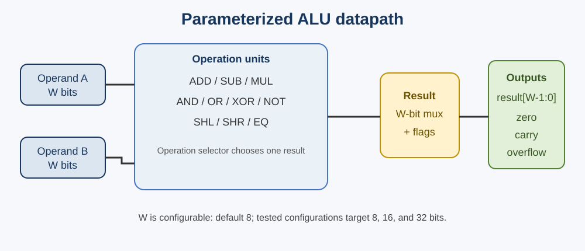
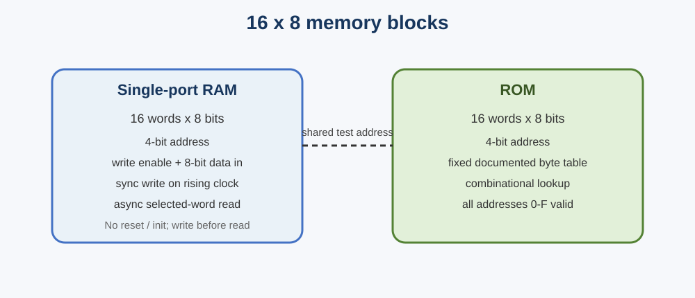

# Task 3 diagrams

## ALU datapath

## Memory blocks

The diagrams show the implemented interfaces and data path at block level. Waveform screenshots are separate evidence captured from GTKWave after running the provided testbenches.
